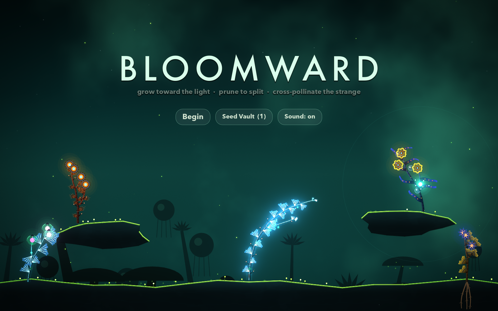

# Bloomward

A living puzzle garden in Godot 4.7. Steer a plant as it grows in real time across luminous alien landscapes. Prune it to split it into new shoots. Cross-pollinate strange wild plants to breed the gifts each garden asks for.



## Play

Double-click **run.command** on macOS, or open `project.godot` in Godot 4.7 (Forward+) and press **F5**.

```sh
/Applications/Godot.app/Contents/MacOS/Godot --path .
```

## How it plays

Your plant grows on its own. The **leading shoot** reaches for light, and side shoots stay shorter and burst into flowers. Each garden has one or more **sunwells**. Wake all of them to make the garden bloom.

- **Lures.** Click to place a glowing lure and drag it to steer. Shoots that reach a lure carry on past it, so a few lures make a route of waypoints. Right-click a lure to take it back.
- **Pruning.** Swipe across a stem to cut it. The cut piece falls away, some of its sap comes back to you, and the stump wakes up as **two new leading shoots**. That's how you send one plant two ways at once.
- **Physical rules.**
  - A stem can only stretch so far into open air. It needs rock to lean on, or it droops.
  - Sap is limited.
  - Darkness stops growth, and lures can't be placed in it.
  - Crystal blocks the way.
  - Ordinary shoots slip off glassy rock and die.
- **Cross-pollination.** Touch a wild plant with any shoot. A fruit ripens with **three hybrid seeds**, and they all go to your **Seed Vault**. Each seed takes every visible feature from one parent or the other: leaf shape, flower form, petal count, both colours, pattern, stem style, and gifts. The reveal screen shows which parent each feature came from. The first seed always carries every gift from both parents.
- **Gifts.**

  | Gift | Comes from | What it does |
  |---|---|---|
  | Thorns | Spinebrush | Shatters crystal |
  | Glow | Lanternwort | Lets the plant grow in the dark and lights the darkness |
  | Tendrils | Hookvine | Clings to glass and climbs it |
  | Roots | Deeproot | Grows down through soil and drinks underground water for sap |
  | Buoyant | Driftcap | Grows floating bladders, so it can reach about twice as far across open air (chasms) |
  | Waxy | Emberwax | Grows through ember vents, the walls of heat that wither other shoots |
  | Glow + Roots | Moonpetal | Carries both gifts at once |
  | Thorns + Tendrils | Briarbell | Carries both gifts at once |

  The later gardens need two or three gifts at once, so you breed across generations.

- **Reading your plant.**
  - Each leading shoot wears a **reach ring**. It drains as the shoot stretches into open air and refills (with a green pulse) when the shoot touches rock. It turns red just before the shoot droops.
  - When a shoot dies, it wilts on the spot with a label saying why: "drooped — no rock to lean on", "slipped on glass", "withered in the heat", "wedged". If the plant runs out of sap, "out of sap" appears at its tip.
- **Growing downward.** Near a lure, shoots stop pulling upward, so you can lead them down into pits and shafts.
- **Tricks in later gardens.**
  - **Dew drops** refill sap.
  - **Gold key-blooms** open stone gates elsewhere.
  - **Decoy wisps** drag shoots toward hazards.
  - **Updrafts** carry shoots so they never droop.
  - **Sleeping sunwells** only wake after the one before them.
- **Stars.** Each garden awards up to 3 stars: bloom it, collect all its dew, and use no more lures and prunes than the garden's par.

There are twenty-one gardens. The first fourteen teach the gifts: First Light, Twin Wells, Crystal Throat, Lanternless, Glass Cliff, Thirst, Shattered Spire, Heart of the Grove, Drift Chasm, Ember Vents, Moon Garden, Briar Gate, Coral Steps and The Long Bloom. The last seven are built around tricks: Lockstone (grow down into a pit to open a gate), False Dawn (a decoy over the vents), Updraft Spires, Two Keys (lures as waypoints), Sunken Bloom (down a shaft into a dark cave), Mirror Wells (sunwells that wake in a chain) and The Heartwood. Each garden unlocks the next. Your seeds, stars and progress are saved automatically.

**Hints:** press **Hint** or **H** to show ghost markers for where to place a lure, where to swipe, and which wild plant to touch. Hints come on automatically in the first two gardens and after you get stuck.

**Keys:** **H** shows hints, **Space** pauses, **F** grows ×2, **R** restarts, **S** opens the seed vault, **Esc** goes to the map. When a plant stops growing, the game explains why and suggests what to try.

## Art

Everything is drawn at runtime with HDR bloom: gene-driven plant rendering, shader-painted rock, glass, crystal, water and living darkness, plus layered megaflora silhouettes, light shafts and drifting spores. A plant's look comes straight from its genome, so hybrids visibly wear features from both parents. The music and sound effects are the original synthesized set in `assets/audio`.

## Code map

- `scripts/genome.gd`: genes, crossing, and where each feature came from.
- `scripts/plant_sim.gd`: real-time growth. Light-seeking, leading and side shoots, leaning on rock, reach limits, darkness, roots, collisions, pruning, pollination.
- `scripts/world_sim.gd`: puzzle geometry and queries.
- `scripts/levels.gd`: the eight gardens and the wild species.
- `scripts/session.gd`: one attempt at a garden.
- `scripts/view/`: `plant_view.gd` (plant rendering), `level_view.gd`, `backdrop.gd`, `fx.gd`, `palettes.gd`.
- `shaders/`: sky, rock, glass, crystal, water, darkness, vignette.
- `scripts/main.gd`: title, map, seed choice, HUD, input, cross-pollination reveal, win and stuck screens.

## Tests

```sh
G=/Applications/Godot.app/Contents/MacOS/Godot
$G --headless --path . --script res://tests/solve_test.gd           # each garden solvable with the right gifts, blocked without them
$G --path . --quit-after 6000 --script res://tests/input_test.gd     # simulated lure / drag / recall / swipe-prune
$G --path . --quit-after 20000 --script res://tests/capture.gd       # screenshots of every screen
$G --path . --quit-after 900 --script res://tests/gallery.gd         # plant gallery: species + hybrids
```

`archive/sprout-brawl/` holds the earlier auto-battler prototype. Godot ignores this folder. The original garden sim is still on `main`.
